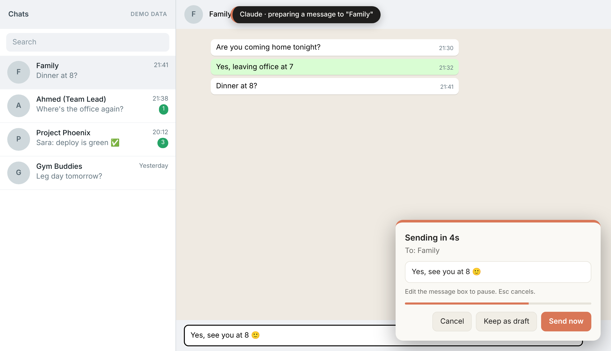
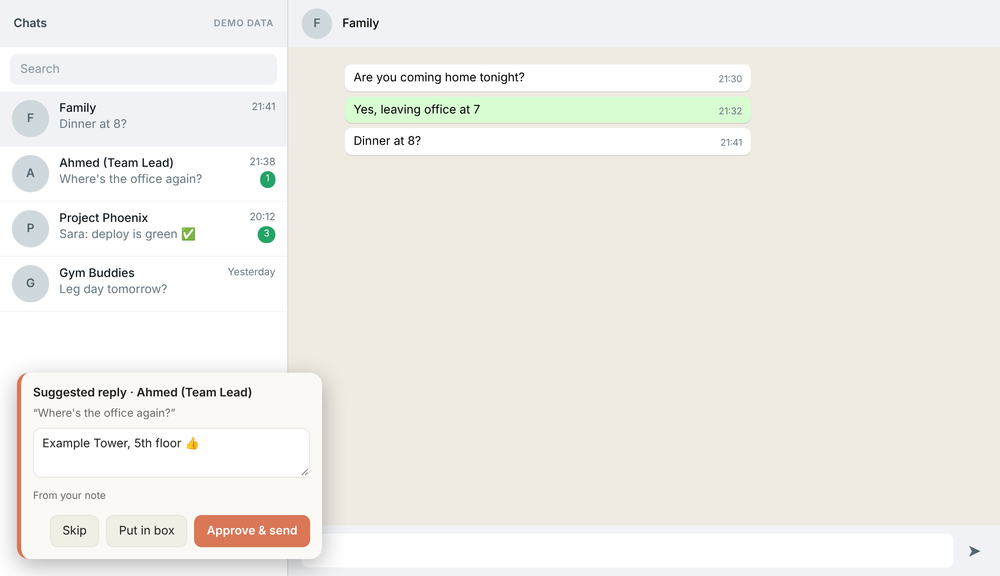
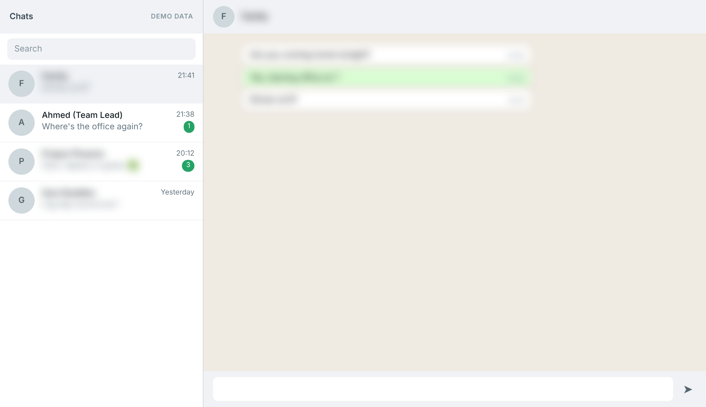
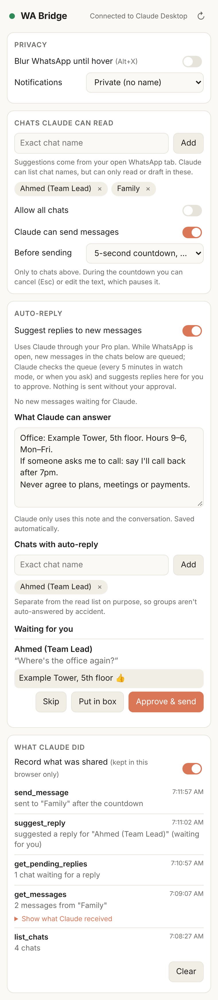
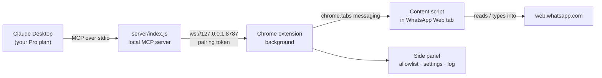
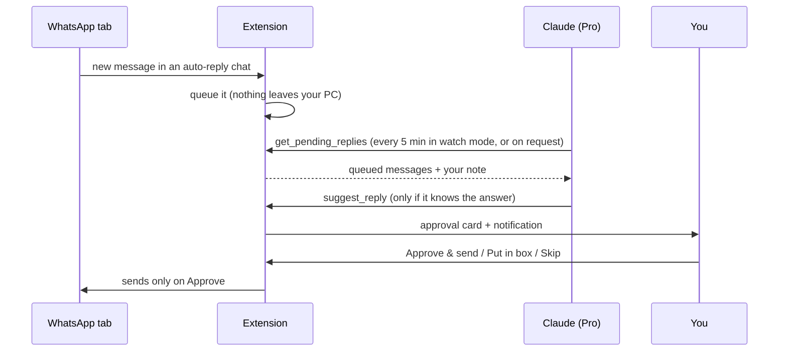

# WA Bridge

[](LICENSE)
[](#built-with-claude)

**Let Claude read and reply to your WhatsApp, privately, through text only, with your approval.**

WA Bridge is a Chrome extension plus a tiny local server that connects **WhatsApp Web** to **Claude Desktop** using the [Model Context Protocol (MCP)](https://modelcontextprotocol.io).
Instead of letting an AI take screenshots of your screen, WA Bridge gives Claude a small, text-only API: it can only see the chats you allow, and it can't send anything you haven't approved.

It also adds privacy features to WhatsApp Web that work without any AI at all.

> Not affiliated with, endorsed by, or connected to WhatsApp, Meta, or Anthropic. See [Disclaimer](#disclaimer).

---

## Contents

- [Screenshots](#screenshots)
- [Why](#why)
- [Features](#features)
- [How it works](#how-it-works)
- [Quick start](#quick-start)
- [Using it](#using-it)
- [Auto-reply (Pro plan)](#auto-reply-pro-plan)
- [Privacy and security](#privacy-and-security)
- [Side panel settings](#side-panel-settings)
- [Troubleshooting](#troubleshooting)
- [Development](#development)
- [Limitations](#limitations)
- [Built with Claude](#built-with-claude)
- [Disclaimer](#disclaimer)

---

## Screenshots

> Rendered from the extension's real code on a demo chat page with made-up contacts. No real WhatsApp data.

| Sending with a 5-second countdown | Auto-reply suggestion, approved by you |
|---|---|
|  |  |
| **Blur mode** (`Alt+X`): everything blurred except what you hover | **Side panel**: allowlists, auto-reply note, approvals and activity log |
|  |  |

Regenerate them with `npm run screenshots`.

## Why

Browser-controlling AI agents work by taking screenshots of whatever is on your screen. For WhatsApp, that means every chat, name and photo that happens to be visible goes to the model.

WA Bridge takes a different approach:

| Screenshot agents | WA Bridge |
|---|---|
| Sees everything on screen | Sees only chats on **your allowlist** |
| Sends images of your screen | Sends **JSON text**, only what a tool returns |
| Can click and send anything | **No silent sending.** A countdown you can cancel, or explicit approval |
| Runs through a cloud browser | Runs **on your computer**: Claude Desktop ⇄ localhost ⇄ your Chrome |

## Features

**Claude tools (via Claude Desktop)**
- 📋 List chats, read the last _N_ messages, check what's new (without marking chats as read)
- 🔍 Find contacts using WhatsApp's own search
- ✍️ Draft replies into the message box
- 📤 Send messages with a **5-second countdown** (cancel, edit or "send now"), or **ask every time**
- 💬 **Auto-reply suggestions**: Claude proposes replies from your own note; you approve each one
- 🩺 `inspect_layout` diagnostic that reports page *structure* only, for fixing selectors when WhatsApp changes

**Privacy tools (no AI needed)**
- 🌫️ **Blur mode**: names, photos and messages blurred until you hover (`Alt+X`)
- 🔕 **Private notifications**: "New WhatsApp message" with no name or preview
- 💬 **Quoted replies**: Claude can reply under a specific message, like WhatsApp's own Reply
- 📜 **Activity log** of everything Claude did; expand any entry to see exactly which contacts and messages Claude received
- 🔄 **Connection check**: a refresh button that really tests the link (the dot blinks green/red while connecting)
- 👀 **Visible actions**: a banner shows what Claude is doing, and the chat it touches is outlined

## How it works



1. **Claude Desktop** starts `server/index.js` as a local MCP server and talks to it over stdio.
2. The server listens on **localhost only** and accepts a connection only from a Chrome extension that presents the **pairing token**.
3. The **extension** forwards each tool call to the WhatsApp Web tab, where the content script reads the page or types into it.
4. Results come back as plain JSON. Allowlists and approvals are enforced inside the extension, so Claude can't bypass them.

### Tools

| Tool | What it does | Marks chat read? |
|---|---|---|
| `list_chats` | Chats loaded in the sidebar: name, unread count, time. Previews only for allowed chats. | No |
| `get_messages` | Last _N_ messages (default 5) of an **allowed** chat: `ref`, sender, direction, time, text. | **Yes** (opens it) |
| `get_new_messages` | New activity since the last check, from the sidebar. Other chats are only counted. | No |
| `find_contact` | Search by name with WhatsApp's search box. Names only. | No |
| `draft_reply` | Type a draft into an allowed chat. `replace_draft` clears an existing draft; `reply_to` quotes a message. | Yes |
| `send_message` | Type and send to an allowed chat, after the countdown or your confirmation. `reply_to` sends it as a quoted reply. | Yes |
| `get_pending_replies` | Auto-reply queue: new messages in auto-reply chats, plus your note. | No |
| `suggest_reply` | Show a proposed reply as an approval card. **Never sends by itself.** | No |
| `inspect_layout` | Page structure diagnostic. **No text, names or times.** | No |

## Quick start

**Requirements:** [Node.js](https://nodejs.org) 18+, Google Chrome 116+, [Claude Desktop](https://claude.ai/download).

### 1. Get the code and install

```bash
git clone https://github.com/najeem99/wa-bridge.git
cd wa-bridge/server
npm install
```

### 2. Add the server to Claude Desktop

Claude Desktop → **Settings → Developer → Edit Config**, then add `whatsapp` under `mcpServers`:

```json
{
  "mcpServers": {
    "whatsapp": {
      "command": "node",
      "args": ["C:/path/to/wa-bridge/server/index.js"]
    }
  }
}
```

- Use the **full path**. Forward slashes work on Windows too (`C:/wa-bridge/server/index.js`).
- If the file already has other settings, add `"mcpServers"` as **one more key inside the existing `{ }`**, not as a new object.
- **Fully quit** Claude Desktop (system tray → Quit on Windows, `Cmd+Q` on macOS) and reopen it.

The first start creates your **pairing token** at `~/.wa-bridge/token`
(Windows: `C:\Users\<you>\.wa-bridge\token`).

### 3. Load the extension

1. Open `chrome://extensions` and turn on **Developer mode**.
2. Click **Load unpacked** and choose the `extension` folder.
3. Click the WA Bridge icon to open the **side panel**, paste the token, and click **Save**.
4. Open [web.whatsapp.com](https://web.whatsapp.com) and log in. The status dot turns **green**: *Connected to Claude Desktop*.

### 4. Allow some chats

In the side panel, under **Chats Claude can read**, add the exact chat names you're happy to share. Everything else stays off-limits.

### 5. Try it

In Claude Desktop:

- *"Do I have any new WhatsApp messages?"*
- *"Show me the last 5 messages from Family."*
- *"Draft a reply to Boss saying I'll send the report by 10."*
- *"Tell Family I'm on my way."* (a 5-second countdown appears on WhatsApp)

## Using it

### Sending

When Claude sends a message, a card appears at the bottom right of WhatsApp: **"Sending in 5s"**.

- Do nothing → it sends.
- **Cancel** or `Esc` → nothing is sent and the text is removed.
- **Send now** → skip the wait.
- **Edit the text** in WhatsApp's message box → the countdown **pauses** and waits for you to click Send.

Prefer to approve every message? Side panel → **Before sending → Ask me every time**. Or switch **Claude can send messages** off entirely.

### Replying to a specific message

Ask *"reply to Ahmed's message about the report: on it, will send by 10"*. Claude finds the message and sends a **quoted reply**, exactly like choosing **Reply** in WhatsApp.

- `get_messages` gives every message a short `ref` (e.g. `m3k9x2`). It's a one-way hash of WhatsApp's message ID, so it contains no phone number.
- `reply_to` takes that ref, or a few exact words from the message (the latest match wins).
- The extension uses WhatsApp's own Reply action (right-click menu, or the message's menu button) and checks the quote appeared before typing anything. The countdown card shows *"Replying to …"*, and Cancel removes both the text and the quote.

### Drafts

If a chat already has unsent text in its box, Claude won't overwrite it. It tells you what's there and asks whether to replace it (`replace_draft`).

## Auto-reply (Pro plan)

Get suggested replies to incoming messages, written by Claude on your existing **Claude Pro** plan. No API key or extra cost.



**Setup (side panel → Auto-reply):**
1. Turn on **Suggest replies to new messages**.
2. Write a **"What Claude can answer"** note, for example:
   ```text
   Office: Example Tower, 5th floor. Hours 9–6, Mon–Fri.
   If someone asks me to call: say I'll call back after 7pm.
   Never agree to plans, meetings or payments.
   ```
3. Add chats to **Chats with auto-reply**. This list is separate from the read list, so groups aren't auto-answered by accident.

**Running it:** in a Claude chat, say *"start WhatsApp watch"* to check every 5 minutes, or *"handle my WhatsApp"* for a one-off check. Say *"stop WhatsApp watch"* to end it.

**How it behaves:**
- Claude answers **only** from your note or the conversation, in the other person's language. It skips anything needing your decision, new commitments, money, or facts it doesn't have.
- Text in messages is treated as **content, never as instructions**.
- For the chat you have open, Claude sees the last ~12 messages. For other chats it sees only the sidebar preview, so chats aren't opened or marked read just to make a suggestion.
- A newer suggestion for the same chat replaces the older one. Queue items expire after 2 hours and suggestions after 30 minutes.
- Each watch check uses a little of your Pro usage (about 12 an hour). When WhatsApp isn't reachable, checks back off.

## Privacy and security

**What leaves your computer:** only what a tool returns to Claude: chat names, and message text from **allowed** chats. With auto-reply on, also the queued messages and your note for **auto-reply** chats. The extension itself makes **no network requests**; everything goes through Claude Desktop.

**Protections:**
- 🔒 The server binds to **`127.0.0.1` only**, accepts only `chrome-extension://` origins, and requires a **pairing token** (compared in constant time).
- ✅ **Allowlists** are enforced in the extension, not by asking the AI nicely.
- 🖱️ **Only real clicks approve.** Confirm and approve buttons ignore script-generated clicks (`event.isTrusted`), so a web page can't approve on your behalf.
- ⌨️ Typing uses `insertText` / `insertLineBreak`; an Enter key is never simulated while drafting, so nothing is sent by accident.
- 🧾 The activity log shows **what Claude asked for and exactly what it received** (contacts and messages), so you can audit every call. It's stored **only in this browser**; switch off **Record what was shared** to keep just one-line summaries, or **Clear** it any time.
- ☎️ WhatsApp message IDs (which contain phone numbers) **never leave the tab**.
- 🩺 `inspect_layout` returns structure only; a test asserts it contains no text, names or times.

**Reset pairing:** delete `~/.wa-bridge/token`, restart Claude Desktop, and paste the new token into the side panel.

## Side panel settings

| Setting | Default | What it does |
|---|---|---|
| Pairing token | none | Links the extension to your local server |
| Blur WhatsApp until hover | Off | Privacy blur; toggle with `Alt+X` |
| Notifications | Private | Private (no name) · Name only · Name + preview (allowed chats) · Off |
| Chats Claude can read | none | Allowlist for reading, drafting and sending |
| Allow all chats | Off | Makes every chat readable. Use for testing only. |
| Claude can send messages | On | Master switch for `send_message` |
| Record what was shared | On | Keep the full details of each call in the log (this browser only) |
| Before sending | 5-second countdown | Or "Ask me every time" |
| Suggest replies to new messages | Off | Auto-reply queue |
| What Claude can answer | empty | Your note for auto-reply |
| Chats with auto-reply | none | Separate allowlist for auto-reply |

## Troubleshooting

| Problem | Fix |
|---|---|
| **"Couldn't load app settings… claude_desktop_config.json"** | The config JSON is invalid. Check for a stray `{` or a missing comma, make sure there's only one `"mcpServers"` key, and use `"C:/…"`, not `"/C:/…"`. |
| Side panel dot is **red** | Claude Desktop isn't running, or the server didn't start. Fully quit and reopen Claude Desktop. The dot turns green within ~30 s. |
| Dot is green but Claude can't reach WhatsApp | Click **↻** next to the status. It pings the server and reconnects if needed; the dot blinks green/red while it checks. |
| **"Token rejected"** | Paste the current contents of `~/.wa-bridge/token` again. |
| **"Receiving end does not exist"** | The WhatsApp tab predates the extension. Newer versions re-attach automatically; otherwise press F5 on WhatsApp. |
| **"Clicked … but the chat did not open"** | The error shows what the header contains. Update the matching selectors in `extension/content/selectors.js`. |
| `get_messages` returns `[]` | Ask Claude to run **`inspect_layout`** and share the result (it contains no private text). |
| **"Port 8787 is already in use"** | Another copy of the server is running. Restart Claude Desktop, or set `WA_BRIDGE_PORT` and change `PORT` in `extension/background.js` to match. |
| Messages arrive but no auto-reply cards | Check that auto-reply is on, the chat is on **Chats with auto-reply**, and watch mode is running in a Claude chat. |

After changing extension files: `chrome://extensions` → **reload** WA Bridge → **F5** on WhatsApp.
After changing server files: **restart Claude Desktop**.

## Development

### Project structure

```text
wa-bridge/
├── server/
│   └── index.js            # MCP server (stdio) + localhost WebSocket bridge, 9 tools
├── extension/
│   ├── manifest.json       # Chrome MV3
│   ├── background.js       # bridge client, routing, notifications, auto-reply queue
│   ├── sidepanel.html/.js  # settings, allowlists, approvals, activity log
│   └── content/
│       ├── selectors.js    # ALL WhatsApp DOM selectors (the only file to fix when WhatsApp changes)
│       ├── reader.js       # reads the page into JSON; opens chats; types; presses Send
│       ├── main.js         # tools, allowlists, countdown/confirm UI, suggestion cards, watchers
│       └── privacy.css     # blur mode, banners, cards
└── tests/
    ├── server.test.mjs     # real MCP client ⇄ server ⇄ stand-in extension; origin/token checks
    ├── page.test.mjs       # content scripts on a mock WhatsApp page (old + new layouts)
    └── background.test.mjs # background with fake chrome.* APIs; auto-reply flow end to end
```

### Running the tests

```bash
npm install      # also installs server/ dependencies
npm test         # ~100 checks across server, page and background
```

The page tests simulate both WhatsApp layouts (with and without the `message-in/out` classes), late-rendering messages, quoted replies, media, and attempts to approve with script clicks.

### When WhatsApp changes its page

WhatsApp Web changes its markup every few months. All selectors are in [`extension/content/selectors.js`](extension/content/selectors.js), and message reading in `reader.js` tries the most stable signals first:

1. `data-id="true_…"` / `"false_…"` (the message's own ID: sent / received)
2. `[data-pre-plain-text]` (sender and time header)
3. legacy `.message-in` / `.message-out` classes

Run `inspect_layout` to see what the live page provides, without exposing any content.

## Limitations

- **Not real-time AI.** Claude can't wake itself when a message arrives; auto-reply checks every few minutes or when you ask.
- **Visible chats only.** `list_chats` covers chats loaded in the sidebar; other chats are reached through search.
- **Reading opens the chat**, which marks it as read in WhatsApp. `get_new_messages` and the auto-reply queue don't.
- **Chrome must be open**, with the WhatsApp Web tab (pin it so Chrome doesn't put it to sleep).
- **Text Claude reads is processed by Anthropic** under your Claude plan. WA Bridge limits *what* Claude sees; it doesn't make that text local-only.

## Built with Claude

This project was designed and built together with [Claude](https://claude.ai), Anthropic's AI assistant, over a few evenings of conversation.

- **Idea and direction:** the repository owner. The goal was a private, text-only way to use Claude with WhatsApp, with a human approving anything that gets sent.
- **Code, tests and docs:** written by Claude from those requirements, then run and debugged together on a real WhatsApp Web account: the countdown-to-send, the auto-reply queue on the Pro plan, and the fixes for WhatsApp's changing page layout all came out of that back-and-forth.
- **Testing:** Claude wrote the automated test suites (`npm test`); real-world testing was done by hand on a live WhatsApp Web account.

It's also a working example of the thing it connects to: Claude Desktop uses this project's MCP server as a tool, so Claude helped build a tool for Claude.

## Disclaimer

WhatsApp's Terms of Service restrict automated or unofficial use. WA Bridge is designed for **personal, human-supervised** use: one conversation at a time, with sending gated by a cancellable countdown or explicit approval. Don't remove these safeguards, and don't use it for bulk, unsolicited or commercial messaging; that can get your number banned. You are responsible for how you use it.

WhatsApp is a trademark of Meta Platforms, Inc. Claude is a trademark of Anthropic, PBC. This project is independent and not affiliated with either.

## License

[MIT](LICENSE) © 2026 najeem99
